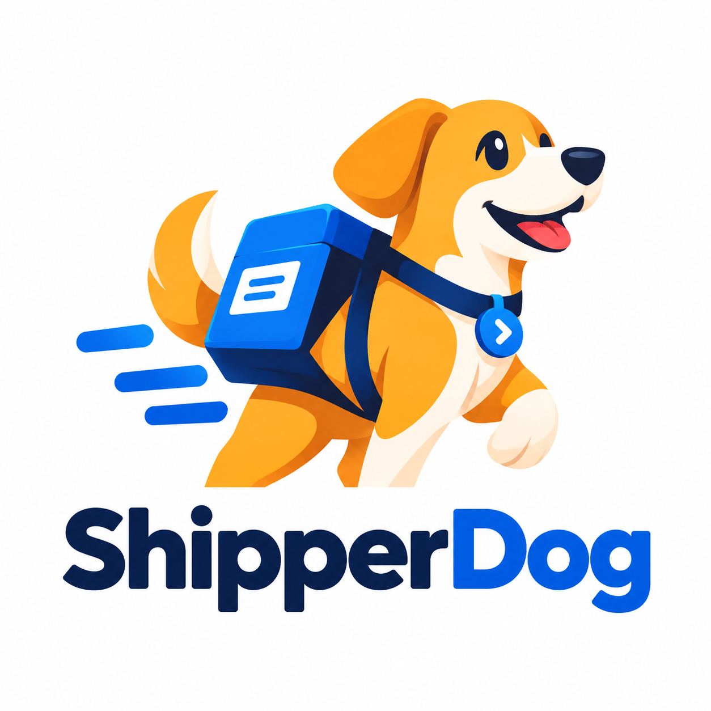

# ShipperDog

<p align="center">
  
</p>

ShipperDog is an enterprise platform for mobile-app beta distribution and
release management: upload builds, route them through workflows and quality
gates, distribute them to testers, and collect feedback.

Status: greenfield scaffold (issue S1-01). The backend skeleton, local
infrastructure, and CI baseline described below are the foundation every
subsequent story builds on.

## Repository layout

| Path | Contents |
|---|---|
| `backend/` | Spring Boot modular-monolith API (Java 25, single Maven module) |
| `frontend/` | Admin console — React 19 + TypeScript + MUI (Vite; S2-04) |
| `portal/` | Tester portal — React 19 + TypeScript + MUI, separate app (S8) |
| `cli/` | Developer CLI — Go 1.26, artifact upload/inspect + login (S5-06) |
| `sdk/` | Tester telemetry SDK — Kotlin/Android + Swift/iOS, zero deps, < 200 KB (S15-01, [docs/telemetry-sdk.md](docs/telemetry-sdk.md)) |
| `infrastructure/` | Local docker compose stack, terraform (Cloud Run, S8-05), smoke + security-header checks, Grafana/Prometheus |
| `docs/` | Developer documentation |
| `.github/workflows/` | GitHub Actions CI + the manual deploy pipeline (S8-05) |

Production deployment (Cloud Run, terraform, post-deploy smoke test):
see [docs/deployment.md](docs/deployment.md).

The backend is a modular monolith: one deployable, with one package per
bounded context (identity, organization, tenant, application, version,
artifact, tester, authorization, release, workflow, environment, gate,
distribution, feedback, device, analytics, integration, notification, audit).
Cross-module imports of `.internal.` packages are rejected by ArchUnit tests
(`backend/src/test/java/com/shipperdog/api/architecture/ModuleBoundaryArchTest.java`).

## Quickstart (docker compose)

Requires Docker (with compose v2).

```bash
docker compose up
```

This starts PostgreSQL 17, Redis 8, a GCS emulator (fsouza/fake-gcs-server),
the API, the admin console (S2-04), and the observability stack
(Prometheus + Grafana, S1-07). Defaults are baked in; to override them,
copy `.env.example` to `.env` and edit.

The admin console (tenant administration, S2-04) is served by nginx at
http://localhost:5173 — same origin as the API through the compose
proxy, so the seeded admin above signs in directly. See
[docs/frontend.md](docs/frontend.md).

The tester portal (S8-01) is a separate app served at
http://localhost:5174 — testers sign in there, and invitation accept
links point at this origin. See [docs/portal.md](docs/portal.md).

Verify the API (management endpoints live on the internal port, published
loopback-only — never on the public API port):

```bash
curl http://localhost:8081/actuator/health
# {"status":"UP","groups":["liveness","readiness"]}
```

Local observability UIs (loopback-only):

- Grafana dashboards: http://localhost:3000 (admin/admin by default)
- Prometheus targets: http://localhost:9090
- Metrics scrape: http://localhost:8081/actuator/prometheus

See [docs/observability.md](docs/observability.md) for the correlation
model, the `shipperdog_*` metric namespace, and the env-var surface.

The dev profile seeds a bootstrap admin (`dev@shipperdog.local` /
`shipperdog-dev-admin`, local only — see `docs/authentication.md`):

```bash
curl -s -X POST http://localhost:8080/api/v1/auth/login \
  -H 'Content-Type: application/json' \
  -d '{"email":"dev@shipperdog.local","password":"shipperdog-dev-admin"}'
```

The developer CLI (S5-06) drives the same API from the terminal —
mint a PAT with the seeded admin above (`POST /api/v1/auth/tokens`),
then see [cli/README.md](cli/README.md) for `login`, `artifact
upload`, and the inspect commands:

```bash
cd cli && go build -o /tmp/shipperdog . && /tmp/shipperdog login
```

Tear down (and drop the local database volume):

```bash
docker compose down -v
```

## Building and testing locally

Requires JDK 25 and Maven 3.9+. Note: if your default `java` is older than
25, point `JAVA_HOME` at a JDK 25 install first.

```bash
cd backend
export JAVA_HOME=$(/usr/libexec/java_home -v 25)  # macOS; adjust per platform
mvn spotless:apply   # format
mvn verify           # format check + build + tests
```

`mvn verify` runs the Spotless format check (pinned to palantir-java-format),
compiles, and runs the test suite. The Spring Boot integration tests use
Testcontainers, so Docker must be running.

## Configuration

All runtime configuration comes from environment variables; nothing secret
is stored in committed files. The compose file wires the services together
using these variables (local defaults in `infrastructure/docker-compose.yml`
and `.env.example`):

| Variable | Purpose | Local default |
|---|---|---|
| `DATABASE_URL` | JDBC URL | `jdbc:postgresql://localhost:5432/shipperdog` |
| `DATABASE_USERNAME` / `DATABASE_PASSWORD` | Database credentials | `shipperdog` |
| `SERVER_PORT` | HTTP port | `8080` |
| `AUTH_JWT_SECRET` | HS256 signing key for auth tokens (min 32 bytes; required) | compose-only dev value |
| `AUTH_ACCESS_TOKEN_TTL` | Access-token lifetime | `PT15M` |
| `AUTH_REFRESH_TOKEN_TTL` | Refresh-token lifetime | `P7D` |
| `AUTH_LOCKOUT_THRESHOLD` | Failed logins before lockout | `5` |
| `AUTH_LOCKOUT_DURATION` | Lockout duration | `PT15M` |
| `AUTH_PASSWORD_RESET_TTL` | Password-reset token lifetime | `PT30M` |
| `AUTH_INVITATION_TTL` | Registration invitation lifetime | `P3D` |
| `SSO_REDIRECT_BASE_URI` | SSO callback base — the OIDC `redirect_uri` and the per-org SAML SP entityID/ACS derive from it (S14-01/S14-02) | `http://localhost:8080` |
| `SSO_CONSOLE_CALLBACK_URI` | Console SSO landing route (every provider kind) | `http://localhost:5173/sso/callback` |
| `SSO_SAML_SP_SIGNING_KEY` | Optional SAML SP signing key (PKCS#8 PEM; empty = unsigned AuthnRequests) | empty |
| `SSO_SAML_SP_SIGNING_CERT` | Optional SAML SP signing certificate (PEM; must pair with the key) | empty |
| `MANAGEMENT_ENDPOINTS_EXPOSE` | Actuator endpoints exposed | `health,info` (compose: `health,info,prometheus`) |
| `MANAGEMENT_HEALTH_SHOW_DETAILS` | Health detail visibility | `never` |
| `MANAGEMENT_SERVER_PORT` | Internal management port (compose sets `8081`) | unset = API port |
| `TRACING_SAMPLING_PROBABILITY` | Trace head-sampling probability | `1.0` |
| `LOGGING_STRUCTURED_FORMAT_CONSOLE` | Structured log format (compose: `logstash`) | plain text |
| `OPENAPI_SERVER_URL` | Advertised server URL in the generated OpenAPI spec | `https://api.shipperdog.dev` |
| `OPENAPI_INFO_VERSION` | Version string in the generated OpenAPI spec | `0.1.0` |
| `SPRINGDOC_API_DOCS_ENABLED` | Serving of `/v3/api-docs` endpoints | `true` |

The API refuses to start without `AUTH_JWT_SECRET`. Production supplies a
high-entropy value from its secret manager; local development uses the
compose default, which is local-only exactly like the database password.

## CI

Three gates run on every pull request and on pushes to `main`:

- `.github/workflows/ci.yml` (backend-ci) runs `mvn verify` (format
  check, build, tests) plus the OpenAPI export/breaking-diff below.
- `.github/workflows/frontend-ci.yml` (frontend-ci, S2-04) runs the
  console's lint, strict-typecheck build, and Vitest suite under
  Node 22 with npm caching.
- `.github/workflows/cli-ci.yml` (cli-ci, S5-06) runs the Go CLI's
  golangci-lint gate, unit tests (including the endpoint contract test
  against the OpenAPI baseline), build, and a linux/darwin amd64/arm64
  cross-compile matrix publishing version-stamped binary tarballs.

Since S1-08 the backend build also
exports the generated OpenAPI contract (`backend/target/openapi.yaml`,
published as the `openapi-spec` artifact) and diffs it against the
committed baseline `docs/openapi/baseline.yaml` with oasdiff — a breaking
API change fails the check until the baseline is consciously re-committed
in the same PR (see [docs/api-conventions.md](docs/api-conventions.md)).

Merge blocking: branch protection on `main` — requiring the
`backend-ci / build-and-test` and `frontend-ci / lint-typecheck-build-test`
status checks and pull requests for all
changes — is the intended policy, but it could not be enabled
programmatically because branch protection requires a public repository or
a paid GitHub plan and this repository is currently private on a free
plan. Until that changes, treat a green `backend-ci` run as a hard review
gate: do not merge a PR whose check has failed or is pending. To enable it
later: Settings -> Branches -> Add branch protection rule for `main`,
require the `backend-ci / build-and-test` status check, require pull
requests.

## Development conventions

- Conventional Commits (`feat:`, `fix:`, `chore:`, `docs:`, `test:`, `ci:`).
- Formatting is enforced by Spotless with a pinned palantir-java-format
  version; run `mvn spotless:apply` before pushing.
- No secrets in committed files; configuration is environment-only.
- Database schema changes arrive with Flyway starting in S1-02; the app
  runs with `ddl-auto: validate` only.
