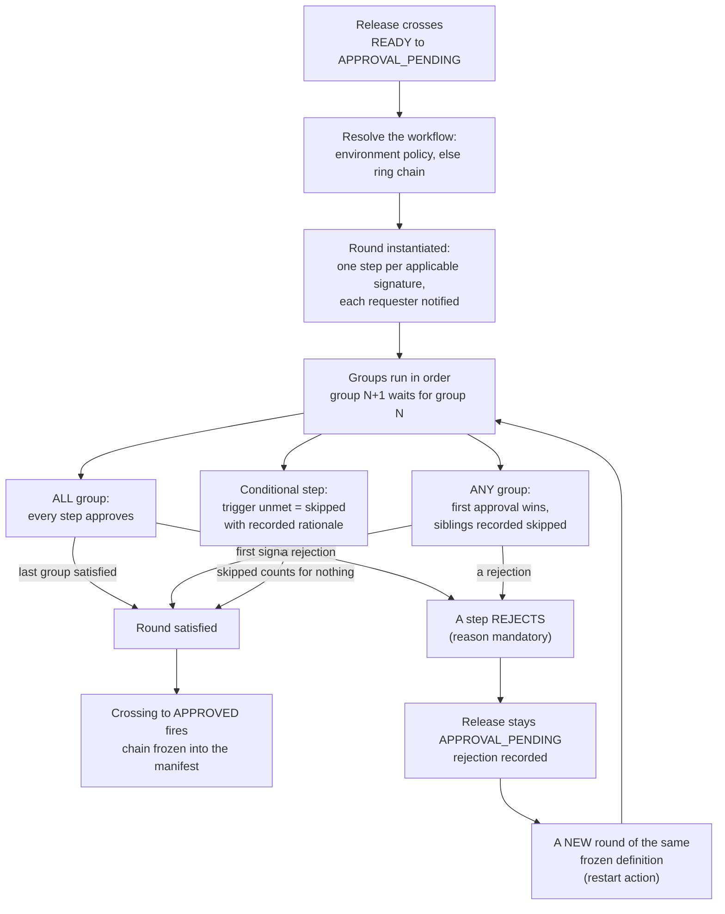

# Approvals and quality gates

Two engines stand between a ready release and your testers: approval
workflows decide that the right people have signed off, and quality
gates decide that the right facts have been recorded. They are
configurable data, not code — an organization that configures neither
keeps an ungated pipeline; an organization that configures both gets a
chain of evidence no one has to remember to collect.

## Approval workflows

An approval workflow is an ordered chain of groups of steps. Each step
demands a signature from one of the five approval roles — `QA_ENGINEER`,
`SECURITY_REVIEWER`, `COMPLIANCE_REVIEWER`, `APP_OWNER` (the product
step), or `RELEASE_MANAGER` (the classic final sign-off). Groups run
sequentially; within a group:

- **ALL** (the parallel mode) — every step in the group must approve.
  All pending siblings are decidable at once.
- **ANY** (the or-mode) — the first approval satisfies the group; the
  remaining steps are recorded as skipped, with which signature
  satisfied them.
- **Conditional steps** — a step can carry a trigger, evaluated when
  the round starts: `ENVIRONMENT_EQUALS` (for example, only demand
  compliance when the release targets production) or
  `FEATURE_FLAG_CONTAINS`. An unmet condition skips the step — never
  silently; the rationale is recorded.

A rejection anywhere rejects the round — a no is never outvoted.

The details that matter in practice:

- **Signatures are facts.** Approver and role are recorded at decision
  time; roles change later, the record does not.
- **The release's creator signs nothing** — self-approval is refused.
- **Rejection is terminal for the round.** The documented rework path
  is a new round of the same frozen definition — never an un-reject.
- **Rounds are per definition, and the chain is what the manifest
  freezes**: the signed steps, in chain order.
- **A named policy that fails to resolve fails closed**: the crossing
  refuses rather than silently running a weaker chain.

## Quality gates

Gates are evaluated facts, not workflows: external systems (usually
your CI) submit results with evidence, the platform records them, and
the release's crossing consults them. The built-in catalog:

| Gate | Kind | Semantics |
|---|---|---|
| `unit-tests`, `integration-tests`, `sast`, `dependency-scan`, `mobile-security-scan` | Pass/fail | Externally reported binary outcome, with a mandatory evidence URL |
| `coverage-threshold` | Minimum | A percentage the definition pins (for example, 80) |
| `crash-free-threshold` | Minimum | Metric-backed: crash-free session rate |
| `open-critical-bugs` | Maximum | Metric-backed: a ceiling, typically 0, fed by feedback triage |

How they bind: gate definitions are organization-grain, with an
optional ring attachment — a ring-attached definition overrides the
organization-wide one for that ring (per-ring gates, PRD's rule).

How they decide:

- **Blocking.** While any required gate of the release's ring is
  pending, failed, or without data, the `VALIDATING` to `READY`
  crossing refuses — and a ring promotion consults the same
  evaluation for the target ring.
- **NO_DATA is not zero and not a pass.** A metric-backed gate with no
  data yet blocks, distinctly from a failure — no data yet is not a bad
  result, but it holds all the same.
- **Results are latest-wins with full history.** Every submission is
  appended; the current state mirrors the newest result.
- **Evidence is mandatory.** Every externally reported result carries
  an http(s) URL a human can follow — the report link, not a claim.
- **Overrides are the governed exception.** A failed or dataless gate
  can be overridden exactly once, with a mandatory reason, by the roles
  that hold the override authority. The row keeps reporting the
  underlying state; the override governs whether it still blocks, and
  the act is audited.
- **Metric-backed gates refuse manual submission** — analytics and
  feedback own their values.

## How the two interlock with feedback

The `open-critical-bugs` gate reads live feedback triage: unresolved
critical reports block promotion into a ring that demands zero.
Resolve the report and the next attempt re-evaluates and passes. That
closed loop — report, triage, metric, gate, promotion — is covered in
[feedback and analytics](/concepts/feedback-analytics.md).

## Release policies (the standing rules)

Beside gates, an organization authors declarative IF/THEN rules that
every promotion evaluates: metrics and gate states in the condition,
`BLOCK` / `HOLD_FOR_REVIEW` / `ALLOW` in the action, scoped to the
organization, an application, a ring, or the targeted environment. A
fired `HOLD_FOR_REVIEW` rule parks the hop until a privileged
acknowledge records the decision — with a reason — and that decision
stands for later hops into the same ring. See
[rings and rollout](/concepts/rings-and-rollout.md).

## Where to go deeper

- [Release lifecycle](/concepts/release-lifecycle.md) — the crossings
  these engines guard
- Developer detail: the approval-workflow, gate, and policy sections of
  the
  [releases](https://github.com/ShristiLabs/shipperdog/blob/main/docs/releases.md)
  module doc, and the
  [CI integration](https://github.com/ShristiLabs/shipperdog/blob/main/docs/ci.md)
  guide for submitting gate results from pipelines.
