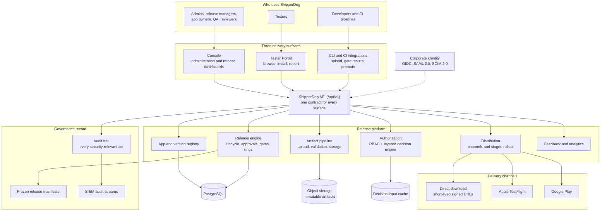
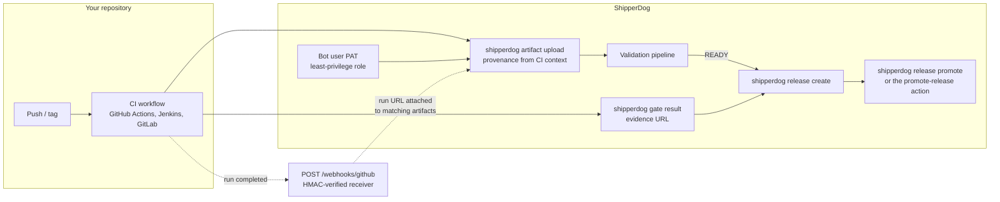

# Platform architecture

ShipperDog is an enterprise platform for distributing mobile builds to
testers and promoting them to production under explicit governance. One
release platform serves three audiences at once: the teams that manage
apps and releases, the testers who install builds on their phones, and
the pipelines that build and upload artifacts automatically.

## The three surfaces

- **Console** — the web application where organization administrators,
  release managers, app owners, QA, and reviewers work. Tenants,
  applications, releases, approval workflows, rings, quality gates, and
  policies are all managed here.
- **Tester Portal** — a separate, standalone mobile web app. Testers
  accept invitations, browse the apps they are authorized for, install
  builds, and submit feedback. Testers never see the Console.
- **CLI and CI** — the `shipperdog` command line and the CI integrations
  (GitHub Actions, Jenkins, GitLab) built on it. Developers upload
  artifacts with provenance, report quality-gate results, and drive
  releases from pipelines.

All three surfaces talk to the same versioned API (`/api/v1`). There is
exactly one authorization model and one audit trail behind everything.

## What each piece does

**App and version registry.** Organizations register applications
(bundle id / package name per platform), own them through tenants, and
give each application logical versions. A version can exist without a
release — nothing reaches a tester until a release says so.

**Artifact pipeline.** Developers upload IPA, APK, or AAB binaries.
Every artifact is stored immutably in object storage, parsed
asynchronously (identity fields such as build number and minimum OS are
extracted from the binary itself), and validated through a seven-stage
pipeline before it becomes usable. See
[artifact pipeline](/concepts/artifact-pipeline.md).

**Release engine.** A release is the governed distribution event: one
version of one application, a set of target tenants and tester groups, a
starting ring, and — from the moment it is approved — a frozen manifest
that answers "exactly what did this tenant receive?" forever. The
lifecycle, approvals, quality gates, and ring promotions all live here.
See [release lifecycle](/concepts/release-lifecycle.md),
[approvals and gates](/concepts/approvals-gates.md), and
[rings and rollout](/concepts/rings-and-rollout.md).

**Distribution.** The platform's own direct-download tier serves
short-lived signed URLs today; Apple TestFlight, the App Store, and
Google Play adapters carry builds into the stores. ShipperDog always
owns authorization and evidence — who may receive what — while the
channel owns installation mechanics.

**Authorization.** One engine decides which resources a person may
reach, through a seven-layer chain from the user down to the active
distribution. Console roles (RBAC) decide who may manage; the layered
engine decides what anyone can see or download. See
[authorization](/concepts/authorization.md).

**Feedback and analytics.** Testers submit structured feedback from the
portal or from inside the app via the telemetry SDK; the platform turns
reports and device events into the metrics that quality gates and
promotion policies read. See
[feedback and analytics](/concepts/feedback-analytics.md).

**The governance record.** Every security-relevant operation — logins,
role changes, uploads, approvals, promotions, downloads, overrides — is
written to an append-only audit trail that can be streamed to your SIEM.
Release manifests freeze the approved content of every release.

## How CI fits

CI integration is optional but first-class. Pipelines authenticate with
a personal access token minted for a dedicated bot user, wrap the CLI,
and drive the whole flow: upload with provenance attached automatically
from the CI context, poll until the artifact is READY, create the
release, report gate results, and promote. Inbound webhook receivers
(`POST /webhooks/github`, `/webhooks/appstore`, `/webhooks/google-play`)
verify signed deliveries so builds and store events can enrich records
without credentials in URLs.

The two composite actions (`upload-artifact`, `promote-release`) wrap
the CLI so a workflow needs no hand-rolled API steps; a failed gate or
a refused promotion fails the job with the complete blocker list in the
job summary.

## Identity

Console users can sign in with email and password or through your
corporate identity provider: OIDC (Google Workspace, Microsoft Entra,
Okta) and SAML 2.0 are both supported, with SCIM 2.0 provisioning to
automate joiners and leavers. See [identity and SSO](/concepts/identity-sso.md).

## Where to go deeper

- [Tenancy and isolation](/concepts/tenancy-isolation.md) — how
  organizations, tenants, and data isolation work
- [Security model](/concepts/security-model.md) — immutability, signed
  URLs, auditing, and the fail-closed posture
- Developer internals (API reference, module docs, ADRs) live in the
  [shipperdog repository's docs directory](https://github.com/ShristiLabs/shipperdog/tree/main/docs)
  — the user documentation links there rather than duplicating it.
