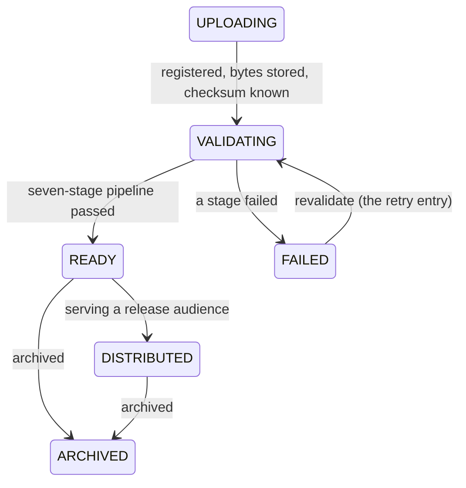

# Artifact pipeline

An artifact is a concrete, immutable binary — an IPA, APK, or AAB.
Everything the platform promises (reproducible releases, trustworthy
manifests, evidence) rests on artifacts being exactly what they claim
to be, so the pipeline between upload and usability is explicit and
mechanical.

## Upload

Developers upload through the Console, the `shipperdog` CLI, or CI.
Two paths, one outcome:

- **Direct upload** for binaries at or under the resumable threshold
  (100 MB).
- **Direct-to-storage sessions** for larger binaries: the platform
  grants a session URL, the client streams bytes straight to object
  storage, and a finalize call registers the artifact.

Alongside the bytes, uploads can carry **build provenance** — git
commit, git branch, pipeline name, CI run URL, build timestamp. The
CI integrations attach these automatically from the pipeline context.
They are claims validated for shape, recorded once, and never
fabricated: a manual upload may assert none.

Two rules hold from the first byte:

- **Immutability.** Stored artifacts are write-once. Re-uploading
  identical content registers a new artifact (with a pointer to the
  duplicate); nothing is ever overwritten or deleted.
- **The version freeze.** The moment a version carries any release —
  a draft counts — its artifact set is frozen. Corrections are a new
  version, never an edit.

## Extraction

Parsing is asynchronous, after the upload returns: the binary's
identity fields — bundle id, version name, minimum OS, build number —
are extracted from the binary itself, not from what the uploader
claims. iOS provisioning-profile facts and Android signing-block
presence are recorded as metadata. The upload response is always
"pending"; read the artifact back to see extraction settle.

## Validation

Once extraction settles, a second async pipeline runs seven ordered
stages, recording every outcome on the artifact:

```text
FILE -> FORMAT -> METADATA -> CHECKSUM -> SIGNING -> APPLICATION_MATCH -> VERSION_MATCH -> READY
```

1. **FILE** — the stored object exists and matches the registered size.
2. **FORMAT** — the container verdict is structural (detected from the
   bytes, never the file name), and coherent with the platform and
   extension. A renamed binary fails with the structural truth
   recorded.
3. **METADATA** — extraction succeeded; a malformed binary fails here
   with its actionable code.
4. **CHECKSUM** — the stored bytes re-prove the registered SHA-256.
5. **SIGNING** — presence and self-consistency: an iOS build must
   carry a coherent, unexpired provisioning profile; an APK must carry
   a v2 or v3 signing block.
6. **APPLICATION_MATCH** — the extracted bundle id / package name
   equals the registered application identifier.
7. **VERSION_MATCH** — the extracted marketing version (and, when
   pinned, the CI build number) equals the version record.

The first failed stage stops the run; later stages record "skipped".
A failed artifact's read answers exactly which stage, which code, and
what to do.

## The state machine



- `READY` is the state releases and version grants accept — nothing
  distributes off a failed or still-validating binary.
- **Revalidation is the retry path**: a failed artifact re-enters
  through `FAILED -> VALIDATING` and the pipeline re-runs. Deterministic
  failures reproduce their verdict, but the world may have changed (a
  corrected registry identifier, recovered storage) — the retry is how
  the corrected fact wins.
- There is deliberately **no revoked artifact state** — revocation is
  an authorization lifecycle (a version's distribution can be revoked),
  never a mutation of the binary's record.
- Infrastructure hiccups (queue full, storage briefly unreadable) are
  recorded blocks, not failures: the artifact stays `VALIDATING` and
  the stall is visible rather than silent.

## Where the artifacts live

Binaries live in object storage under a path keyed by organization,
tenant, application, version, and artifact id; PostgreSQL holds only
metadata, never bytes. Downloads never hand out that layout — testers
receive short-lived signed URLs minted per decision (see the
[security model](/concepts/security-model.md)).

## Where to go deeper

- [Release lifecycle](/concepts/release-lifecycle.md) — what happens
  once artifacts are READY
- Developer detail: the
  [artifacts](https://github.com/ShristiLabs/shipperdog/blob/main/docs/artifacts.md)
  module doc (routes, extraction failure codes, the validation stages,
  provenance field contract).
