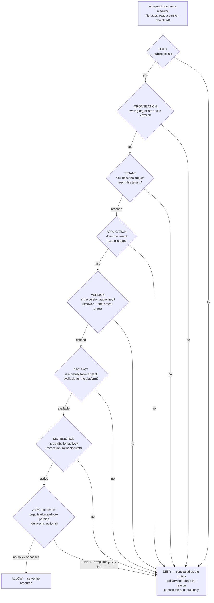

# Authorization

ShipperDog's design principle is explicit authorization: nobody can
reach anything by default, and every decision is recorded. Two engines
 cooperate — one decides who may manage, the other decides what anyone
may reach.

## Roles (who may manage)

Console authority is role-based, evaluated live from the database on
every request — role changes take effect immediately, never at the next
token refresh. Organization roles, tenant roles, and the platform
administrator flag feed one permission matrix. Plain membership grants
nothing; every functional role earns specific capabilities (an
`ORG_ADMIN` administers everything organization-wide; a `DEVELOPER`
uploads artifacts; a `QA_ENGINEER` triages feedback and signs the QA
step; and so on). Effective permissions are the union of every role a
person holds.

## The layered decision (what you may reach)

Which applications a tester can see, which versions, which downloads —
that is decided by a second engine that walks seven ordered layers,
from the person down to the live distribution:

The first failing layer short-circuits the walk. The engine fails
closed: a fault is a denial, never an allow.

## Grants: how testers get access

Testers are not given roles — they are given **version grants**, and
the grant shapes are deliberately simple:

| Shape | What it authorizes |
|---|---|
| Explicit version | Exactly one named version |
| Application | Every version of the application the granting tenant can see |
| Tag | Every version carrying the tag (newly tagged versions join automatically) |
| Latest N | The N newest working-set versions — the window slides as builds arrive |

Grants compose with union semantics, can carry an expiry (evaluation
time — expired grants never authorize but stay on record), and can be
revoked or bulk-revoked with a mandatory reason. Revocation is a state
flip, never a deletion: history stays, and it takes effect on the very
next decision.

Two switches must both be on for a tester's access: the tester person
record active, and the tenant membership active. Suspending either one
denies every decision immediately.

## Opaque denials

A caller who is not authorized learns nothing: resource-scoped denials
render as the byte-identical `404` a genuine miss produces. A tester
who asks about a version they were never granted cannot distinguish
"does not exist" from "not yours" — which check failed lives in the
audit trail alone. This is deliberate (PRD 12): existence is itself
information.

## The decision API

The tester portal rides three self-scoped endpoints that are decided
by this engine and nothing else: the authorized application catalog,
the authorized version history, and the download decision that mints
short-lived signed URLs. The sets are computed server-side — never a
client-side filter of a bigger list.

## ABAC refinement

Organizations can author attribute-based policies — typed conditions
over attributes like the caller's role, the application's name, the
target environment, the ring being entered — with `DENY` and
`REQUIRE` effects. ABAC can only narrow access: there is no allow
outcome, and a policy no grant backs authorizes nothing. The same
engine is consulted on ring promotions ("can promote only when
security gates pass"), where refusals name the rule that fired.

## Where to go deeper

- [Tenancy and isolation](/concepts/tenancy-isolation.md) — the
  dimensions the chain walks
- [Security model](/concepts/security-model.md) — what happens to
  decisions after they are made (audit, SIEM)
- Developer detail: the
  [authorization](https://github.com/ShristiLabs/shipperdog/blob/main/docs/authorization.md)
  module doc (the full role matrix, grant endpoints, the ABAC engine,
  the isolation test suite).
