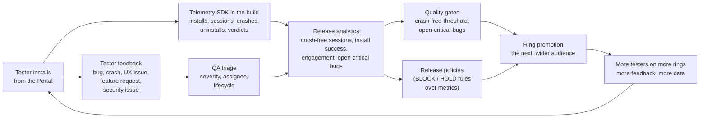

# Feedback and analytics

ShipperDog closes the loop between "we shipped a build" and "is it any
good": testers report issues, devices report events, the platform
turns both into metrics, and the metrics are what quality gates and
promotion policies read. Widening a release is decided by evidence,
not optimism.

## The loop

## Feedback

Testers submit one of six report types — bug, feedback, crash, feature
request, UX issue, security issue — from the portal (or from inside
the app, via the SDK's handoff). The platform attaches the context
automatically: application, version, build, tenant, tester, device,
OS, and the release being evaluated. Attachments (screenshots, videos,
logs) ride along.

QA works the queue: severity (`CRITICAL` / `MAJOR` / `MINOR`) is
assigned at triage, reports are assigned and move through a lifecycle
(`OPEN` to `TRIAGED` to `RESOLVED` or `REJECTED`, re-openable), and
closing crossings carry a mandatory note. Security-issue reports have
restricted visibility — below the security bar, they conceal as if
they did not exist, in listings, details, and counts alike.

The number that gates promotions: **open critical bugs** — the count
of unresolved critical reports for the release, computed live. A
promotion into a ring whose gate demands zero refuses while any
critical report is unresolved; resolve it and the next attempt passes.

## Analytics

The metric dictionary, computed per release (and per ring in the
rollups):

| Metric | What it is |
|---|---|
| Downloads | Allowed download issuances — internal, day one |
| Installations | `INSTALL` events from devices |
| Install success rate | Succeeded installs over reported installs |
| Crash-free sessions | 1 minus crash sessions over total sessions |
| ANR rate | Application-not-responding sessions over total |
| Uninstall rate | Uninstalls over installs |
| Tester engagement | Targeted testers who downloaded over targeted testers |
| Approval duration | Average time to decide approval rounds |
| Time in ring | How long the release has occupied its ring |

Two rules govern honesty here:

- **No data is not zero and not a pass.** A metric with no device
  events yet answers `NO_DATA` — shown distinctly from a failure, but
  it blocks whatever demanded it, all the same, until data arrives or
  the governed override applies.
- **Rates never sum.** Counts aggregate; rates recompute at every
  grain — the dashboards fold series accordingly.

## The telemetry SDK

The metrics that need device-side facts come from a small, dependency-
free SDK embedded in test builds (Android ~36 KB, iOS ~183 KB): it
reports install confirmations, session summaries with crash/ANR
counts, uninstalls, and the tester's verdict, batching offline with
deduplication. It pairs with the download that delivered the build —
the portal's install dialog surfaces the token — and it never replaces
your crash tooling: it is a beacon for release evidence, not another
Sentry. In-app feedback hands off to the portal with the crash summary
prefilled; nothing posts itself.

## Where the numbers surface

- **The release dashboard** — current dictionary per release, beside
  the gates, approvals, and timelines.
- **The organization and tenant dashboards** — counts, per-application
  release health, pending actions, and downloads-per-day charts.
- **The OTA dashboard** — the update funnel for OTA-enabled
  applications: checks counted server-side, the download-apply journey
  device-reported ([OTA updates](/concepts/ota-updates.md)).
- **Gates and policies** — the two engines above.

## Where to go deeper

- [Approvals and gates](/concepts/approvals-gates.md) — what the
  metrics feed
- [Rings and rollout](/concepts/rings-and-rollout.md) — what the
  gates unlock
- Developer detail: the
  [analytics](https://github.com/ShristiLabs/shipperdog/blob/main/docs/analytics.md),
  [dashboards](https://github.com/ShristiLabs/shipperdog/blob/main/docs/dashboards.md),
  and
  [telemetry SDK](https://github.com/ShristiLabs/shipperdog/blob/main/docs/telemetry-sdk.md)
  docs.
