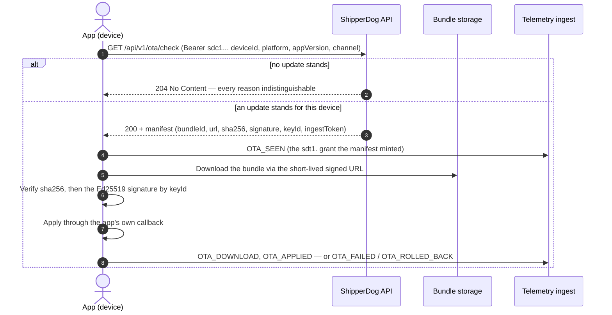

# OTA updates

Some apps can update themselves: React Native, Flutter, and
Electron-style apps ship a runtime that applies new content and logic
without waiting on a store review. For those, ShipperDog distributes
OTA (over-the-air) updates — platform-agnostic bundles governed,
signed, staged, and monitored with exactly the same rigor as store
releases.

The choice is mechanical: send what the app can apply at runtime
(a JS bundle, refreshed assets) as an OTA bundle; send anything that
changes the native binary through the ordinary store-release path. An
OTA bundle is never a side channel — it rides the same releases,
approvals, and gates everything else rides.

OTA is opt-in per application: the application's OTA toggle is turned
on in the console, and the app gets an app-scoped Ed25519 signing key
(the private half stays inside ShipperDog's secret store; the public
half is copyable from the console for embedding in the app).

## From bundle to release

An OTA update is a bundle with its own lifecycle:

| Stage | What is true |
|---|---|
| Draft | The author uploads a platform-agnostic archive; it gets its own version row, a version label, a platform tag, and a minimum store version. |
| Signed | Finalize computes the sha256 and size, then signs with the app's Ed25519 key. Only a signed bundle can publish. |
| Released | The bundle publishes on an ordinary release over a ring whose distribution channel is `ota` — exactly one bundle per OTA release. |

Because an OTA release is an ordinary release, the whole governance
stack applies unchanged: approval workflows, quality gates, policies,
and status history all guard it, and the release dashboard reads the
same as any other. Widening the audience is the same ring promotion;
pulling it back is the same rollback crossing.

Two withdrawal rules follow from that linkage: a signed-but-unreleased
bundle is the author's to revoke, while a released bundle belongs to
its release — pulling it back is the release's rollback, not a bundle
delete. The rollout can also be halted (below), which stops new
devices from seeing the update without touching the release.

## The device flow

The shipped app carries an `sdc1.` app token — an identifier, not a
secret — and polls one endpoint, `GET /api/v1/ota/check`, on a
server-owned cadence (the manifest returns `pollIntervalSeconds`,
default 3600):



The manifest tells the device everything it needs:

| Member | Meaning |
|---|---|
| `bundleId` / `bundleVersion` | The served bundle's id and version label — every lifecycle report attributes back through `bundleId`. |
| `url` | A short-lived signed download URL, minted for this check. |
| `sha256` / `sizeBytes` | Verify the downloaded bytes end to end. |
| `signature` / `keyId` | The Ed25519 signature over the sha256, and which signing-key generation made it. |
| `forced` / `minAppVersion` | Whether the update must apply, and the oldest store version it applies to — defaults from the bundle, overridable per release target. |
| `ingestToken` | A short-lived `sdt1.` grant for reporting this update's lifecycle. |
| `pollIntervalSeconds` | When to check again. |

The 204 is deliberately opaque: up to date, not eligible, a paused or
halted rollout, a stage the device has not reached, or no live release
— all the same bytes, because the split lives in ShipperDog's
server-side counters, never on the wire. A malformed request is the
one coded error the check returns; a bad token is the ordinary 401.

Verification is end to end: the device checks the sha256 and the
Ed25519 signature against the public key embedded in the app — the
signature is never just transport trust. Signing keys rotate by
generation: a new `keyId` supersedes, and old signatures stay
verifiable against the retained public half until the generation
retires.

## Staged device rollout

One rollout plan per OTA release: a ladder of cumulative stages, each
a basis-point threshold (10000 = everyone), advanced manually or
automatically per the plan's mode. Which devices a stage covers is
decided on the fly, deterministically:

```
hash(deviceId, planSalt) mod 10000 < stage.basisPoints
```

The same device lands in the same bucket for the life of the plan — no
cohort table, nothing to backfill — and a device below the current
stage's threshold gets the same 204 as an up-to-date device.

| Standing | What it means |
|---|---|
| Running | Stages admit devices per the ladder. |
| Paused | Devices hold; already-served devices keep their manifest. |
| Halted | The human stop. Every control crossing is audit-trailed. |
| Complete | The ladder reached everyone. |

Pause, resume, advance, and halt are one-action controls from the
console or CLI. Halting is deliberately manual: alert rules watch
failure rates and crash-free regressions and page a human through the
notification bus, but no threshold ever stops a rollout by itself —
the halt is one audited action away.

## Watching the funnel

The funnel's two halves come from different places by design. Checks
are counted server-side; the device-side journey — seen, download,
apply, fail, roll back — is reported by the app as lifecycle
telemetry through the ordinary analytics ingest. The OTA dashboard
reads both halves together, and alert rules turn degradation signals
into notifications for a human to act on.

v1 ships full bundles only: a device always downloads the complete
archive. Delta bundles are a recorded future direction, not current
behavior.

## Where to go deeper

- [Manage OTA bundles](/how-to/console/ota-bundles.md) — enable
  OTA, upload and sign a bundle, issue device tokens, author
  alert rules
- [Run OTA rollouts](/how-to/console/ota-rollouts.md) — attach
  the ladder, drive the controls, read the OTA dashboard
- [Release lifecycle](/concepts/release-lifecycle.md) — the machine
  every OTA release rides
- [Rings and rollout](/concepts/rings-and-rollout.md) — the promotion
  ladder an `ota`-channel ring sits on
- [Feedback and analytics](/concepts/feedback-analytics.md) — the
  telemetry loop the lifecycle reports join
- [Error codes](/reference/error-codes.md) — the OTA codes a console
  operator meets
- Developer detail: the
  [OTA device contract](https://github.com/ShristiLabs/shipperdog/blob/main/docs/ota.md)
  and
  [ADR-0010](https://github.com/ShristiLabs/shipperdog/blob/main/docs/adr/ADR-0010-ota-updates.md)
  — the full wire reference and the decision record.
