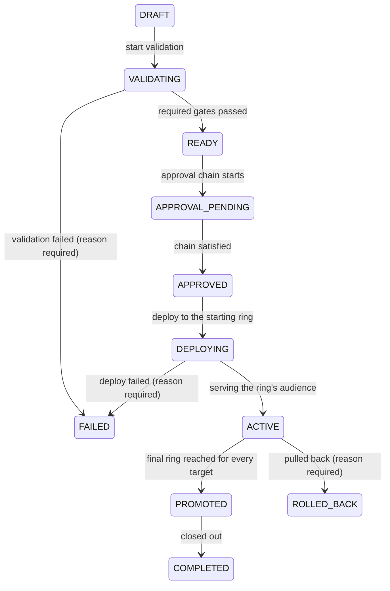

# Release lifecycle

A release is a controlled distribution event: one version of one
application, a set of target tenants (optionally narrowed to tester
groups), a starting ring, and one artifact per platform. Nothing
reaches a tester until a release says so — and every step a release
takes is explicit, ordered, and recorded.

One release exists per application and version. A version can exist
without a release; releases reference versions, never the reverse.

## The state machine

A release moves through exactly this machine — nothing else is legal,
and the table is exhaustive:

Eleven edges, three terminal states: `FAILED`, `ROLLED_BACK`, and
`COMPLETED`. No state exits a terminal, no state re-enters itself, and
no state re-opens artifact mutation — the artifact set freezes the
moment the release is created.

## What each stage means

| State | What is true |
|---|---|
| `DRAFT` | The release exists: version, artifacts, ring, and targets are pinned. Creation already validates that every artifact is `READY`, belongs to the version, and that every target tenant holds the application. |
| `VALIDATING` | Quality gates instantiate for the release's ring. A required gate that has not passed (or has no data yet) refuses the crossing to `READY`. |
| `READY` | The artifact-and-gate side is settled. The approval leg can begin. |
| `APPROVAL_PENDING` | The resolved approval workflow runs its rounds. A satisfied round lets the crossing fire; a rejected round holds the release here until rework. |
| `APPROVED` | Every gate of governance has passed. The frozen manifest is written at this exact crossing — the immutable record of what ships, to whom, under which approvals. |
| `DEPLOYING` | Distribution is being driven to the starting ring's audience. |
| `ACTIVE` | The release serves its audience. Downloads flow; feedback and metrics accumulate. |
| `PROMOTED` | Every target has reached the final ring. Hops may already have widened distribution ring by ring. |
| `ROLLED_BACK` | Terminal. The one-action rollback pulled the release: direct downloads are cut, store assignments reverted, channel records rolled back — while artifacts and history stay untouched. |
| `COMPLETED` | Terminal. The operator's explicit close-out after `PROMOTED`. |
| `FAILED` | Terminal, with a mandatory recorded reason. |

## The rules that make it trustworthy

- **Reasons are mandatory on the dark edges.** A release that fails or
  is rolled back explains itself; the reason rides both the timeline
  and the audit event.
- **Transitions are compare-and-set.** Two racing crossings can never
  both commit; the loser re-reads and answers a precise conflict
  (`RELEASE_TRANSITION_INVALID`, carrying the current and attempted
  states).
- **Every crossing is history.** Each committed transition appends one
  append-only timeline row — actor, from, to, reason, timestamp. The
  release dashboard renders this timeline; nothing is ever rewritten.
- **Policy engines guard the crossings.** The approval engine refuses
  `APPROVED` while a round is pending or rejected; quality gates refuse
  `READY` while a required gate is unpassed. Policies can refuse; they
  can never widen the machine.
- **A failed release never re-enters the machine.** Its artifacts
  cannot be fixed in place — the fix path is a new version with
  corrected artifacts and a new release. The failure and its reason
  stay as permanent history.
- **Rollback never deletes.** A rolled-back version, its artifacts, and
  the release's whole history stay readable; downloads are simply
  refused from then on. The portal shows what was pulled — it just
  will not serve it again.

## The frozen manifest

At the `APPROVED` crossing, ShipperDog writes the release manifest: a
complete, immutable document of what ships — artifacts pinned by
content (SHA-256, build number, size, filename), the target set with
group selections, the ring, the environment and its resolved
configuration, and the satisfied approval chain. It answers the
compliance question — "exactly what did this tenant receive on this
date?" — from its own stored bytes, carries a content digest, and is
served as JSON or YAML. Two approved releases of the same application
can be diffed artifact-by-artifact.

## Where to go deeper

- [Approvals and gates](/concepts/approvals-gates.md) — the engines
  that guard two of these crossings
- [Rings and rollout](/concepts/rings-and-rollout.md) — what happens
  between `ACTIVE` and `PROMOTED`
- [OTA updates](/concepts/ota-updates.md) — OTA-channel releases ride
  this same machine, one signed bundle per release
- Developer detail: the
  [releases](https://github.com/ShristiLabs/shipperdog/blob/main/docs/releases.md)
  module doc (model, transitions API, manifest, promotion engine).
