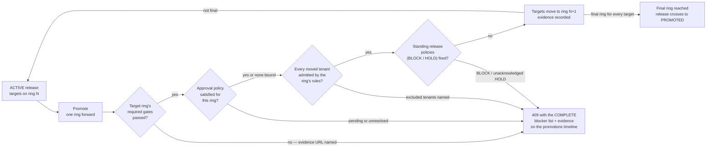

# Rings and rollout

Once a release is `ACTIVE`, distribution widens stage by stage through
rings — an ordered ladder of audiences, each with its own rules. Rings
are how "test with five people, then the pilot tenant, then everyone"
becomes a governed, evidenced process instead of a hopeful one.

## The five default rings

Every organization starts with the same five rings, in this order:

| Position | Ring | Typical audience |
|---|---|---|
| 0 | `engineering` | Internal engineers dogfooding the build |
| 1 | `qa` | QA and structured test passes |
| 2 | `tenant-pilot` | The first real tenant population |
| 3 | `uat` | User acceptance testers |
| 4 | `production` | Everyone the release targets |

Organizations can customize the ladder: add rings, rename them, shadow
a system ring with their own definition, and set each ring's rules.
Only two things are fixed: the order is a strict ladder, and production
stays last — a non-production ring can never take a position at or past
it.

## What each ring carries

A ring is reference data plus rules:

- **Eligibility** — which tenants and tester groups the ring admits.
  A ring with no eligibility rule admits every release target; rules
  narrow. At ring X, the audience is the release's targets intersected
  with the ring's rules.
- **Approval policy** — the named approval workflow that governs
  entering the ring.
- **Quality gates** — the required gate set attached to the ring (plus
  the organization-wide defaults).
- **Promotion policy** — manual or automatic (manual is the standing
  default).
- **Channel reference** — where the ring ships.

Writing the production ring requires governance by default: it must
carry an approval-policy reference and at least one required gate. The
widest audience is never open by omission.

## The governed hop

One action widens distribution: promote moves a release's targets one
ring forward in the ladder — but only when every leg of the target
ring's evaluation passes, evaluated live at the moment of the call:

A refused attempt answers `RELEASE_PROMOTION_BLOCKED` carrying the
complete blocker list — each blocking gate with its evidence, the
approval standing, any excluded tenant with its reason, and every
policy refusal — and records that refusal on the append-only
promotions timeline. The same evaluation is available as a read (the
precheck), so "why can't I promote?" is a screen, not a support
ticket.

## How the hops behave

- **The default hop is exactly one ring forward.** Skipping is refused
  unless the organization explicitly widens its skip allowances — and
  even then, forward only, with every policy admitting the hop.
- **A move set must sit on one ring.** Promote moves every target, or
  the selective tenants you name (Acme first, Contoso later). A set
  straddling rings is refused with each tenant's ring named.
- **A policy-gated ring opens an approval round on the first
  attempt.** The attempt answers blocked-on-the-round; approvers
  decide; the next attempt proceeds when satisfied. A rejected round's
  rework path is the next promote attempt.
- **Promotion never mutates artifacts.** The engine moves ring ids and
  writes timelines, audits, and events — the artifact SHA-256s and the
  frozen manifest stay untouched by construction.
- **Concurrent promotions are serialized.** A concurrent hop that moved
  a target first answers a precise conflict; nothing partially moves.

## Staged tenant rollout

Inside the final ring, distribution can stage across the tenant
population — pilot tenants, then a percentage of tenants, advancing in
stages — with a one-action rollback that cuts direct downloads,
reverts store assignments, and records everything. Apps that opted
into [OTA updates](/concepts/ota-updates.md) stage by deterministic
device buckets instead, on a ring whose channel is `ota`. The staged
rollout walk-through is a Console how-to; this page is the model it
rides.

## Where to go deeper

- [Approvals and gates](/concepts/approvals-gates.md) — the two
  engines the hop consults
- [Feedback and analytics](/concepts/feedback-analytics.md) — where
  the metric-backed gate values come from
- Developer detail: the rings and promotion sections of the
  [releases](https://github.com/ShristiLabs/shipperdog/blob/main/docs/releases.md)
  module doc.
