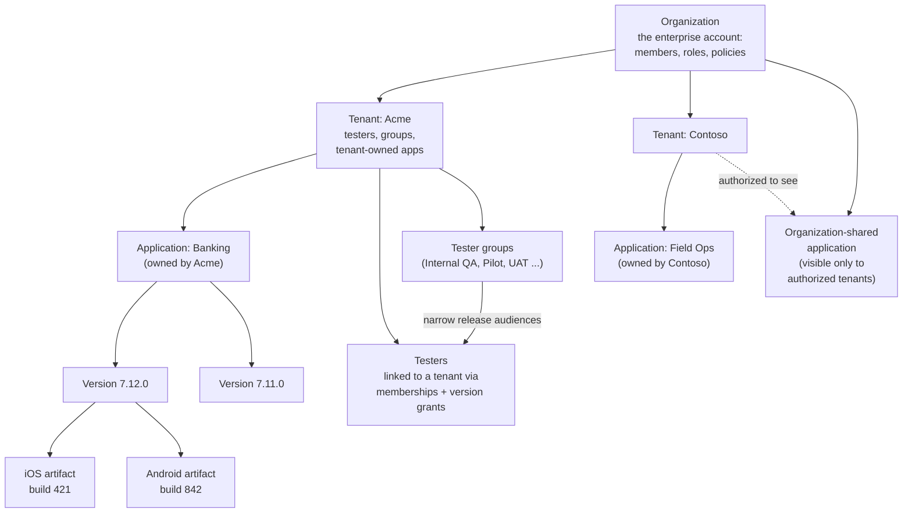

# Core concepts

Five nouns explain almost everything in ShipperDog. Once you can draw
them on a napkin, the Console, the portal, and every how-to guide will
read naturally.

## The model

```text
Organization  ShipperDog Labs Inc.
└── Tenant    Acme  (a customer or business entity)
    └── Application  Banking  (bundle id / package name per platform)
        └── Version  7.12.0  (a logical version)
            ├── Artifact  iOS build 421  (immutable binary)
            └── Artifact  Android build 842
```

A **release** then takes one version's artifacts to a chosen audience
through rings — that is the distribution story, covered in
[release lifecycle](/concepts/release-lifecycle.md).



## Each noun in one paragraph

- **Organization** — the top-level account your company administers.
  Members hold roles here (organization admin, app owner, developer,
  QA engineer, release manager, security reviewer, compliance
  reviewer). Rings, approval workflows, gate definitions, and release
  policies belong to the organization.
- **Tenant** — a customer or business entity inside the organization.
  Tenants own populations of testers and (usually) their applications.
  Data is isolated per tenant, by construction.
- **Application** — a mobile app under management, registered with its
  bundle id (iOS) and/or package name (Android). Owned by one tenant,
  or shared by the organization and selectively authorized to tenants.
- **Version** — a logical release-train of one application (7.12.0).
  Born draft; carries one artifact per platform; its set of artifacts
  freezes the moment any release references it.
- **Artifact** — the concrete immutable binary a tester installs.
  Validated through a seven-stage pipeline before anything can
  distribute it; identified by SHA-256; never edited or replaced.
- **Tester** — the person on the phone. Linked to tenants, organized
  in groups, and granted access to versions (explicitly, by
  application, by tag, or "latest N"). Testers use only the
  [Tester Portal](/get-started/five-minute-install.md).

## How a build reaches a phone

1. A developer or CI uploads an artifact with provenance
   ([artifact pipeline](/concepts/artifact-pipeline.md)).
2. Validation proves it is what it claims to be; the artifact becomes
   ready.
3. A release manager creates a release: version, artifacts, starting
   ring, target tenants and groups
   ([release lifecycle](/concepts/release-lifecycle.md)).
4. Approvals and quality gates clear the release
   ([approvals and gates](/concepts/approvals-gates.md)).
5. The release goes live on its starting ring; promotion widens it
   ring by ring ([rings and rollout](/concepts/rings-and-rollout.md)).
6. Testers the rings and their grants admit see the build in the
   portal and install it; feedback and metrics flow back
   ([feedback and analytics](/concepts/feedback-analytics.md)).

## Next

- [Platform tour](/get-started/platform-tour.md) — walk the Console
  end to end
- [Five-minute install](/get-started/five-minute-install.md) — the
  tester's golden path
- [Concepts](/concepts/) — the deep dives
