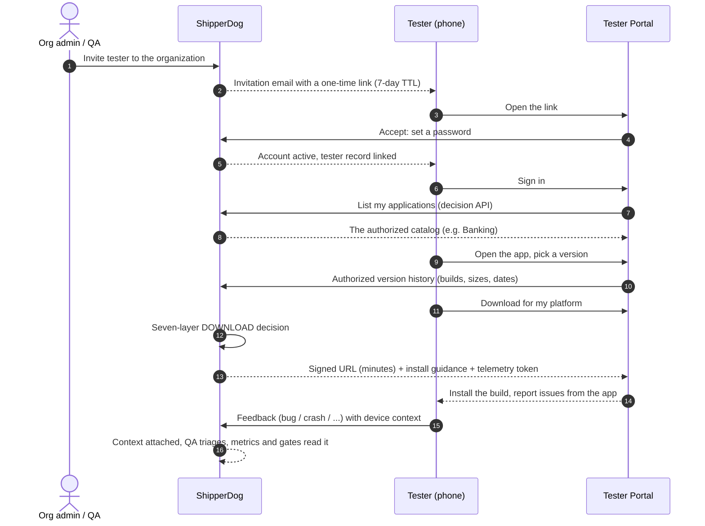

# Five-minute install

The tester golden path: from an invitation email to a running build in
under five minutes, with no Console access and no help from anyone.
This is the whole portal experience — if any step here feels slower
than it should, that is a bug in our promise.

## The steps

### 1. Accept the invite

Open the invitation link on your phone. You will be asked to set a
password — that is the entire registration. The link is single-use and
expires after seven days; ask for a fresh one if it has gone stale.

::: tip No Console account needed
Testers are not organization members and never see the Console. Your
access is your tenant membership plus the version grants an
administrator configured — see [authorization](/concepts/authorization.md).
:::

### 2. Sign in and see your apps

Sign in at the portal address your team gave you. The home screen is
**My Applications**: one card per application you are authorized to
install, with its latest authorized version and per-platform
availability. An honest empty catalog means you have no grants yet —
contact your QA or tenant admin; it is never an error state.

### 3. Pick a version

Tap a card to see the app's version history — newest first, each with
its status badge (draft, active, archived, revoked), the build number,
size, and upload date. Every version is a shareable deep link, which
is handy when reporting an issue against exactly one build.

### 4. Install

Tap **Download** for your platform. The portal asks ShipperDog whether
you may have this build; an allow returns a short-lived signed URL
together with install guidance:

- **Android (direct)** — you may be asked to allow installs from this
  source once; then the APK installs.
- **iOS (direct)** — works for ad-hoc or enterprise-signed builds with
  your device registered; most iOS testing flows through TestFlight
  instead, and the guidance will say so when that is the route.

If the download dialog offers a **telemetry token**, the build you are
installing embeds the ShipperDog SDK — nothing for you to do; install
and crash context flows back automatically.

### 5. Report issues

**Report issue** on any version opens the feedback form: pick a type
(bug, feedback, crash, feature request, UX issue, security issue),
describe it, optionally attach screenshots, videos, or logs. The
platform attaches the context for you — app, version, build, device,
OS — so "which build were you on?" is a question nobody has to ask.

That is the whole loop. QA triages your reports; critical ones gate
promotions; your installs and sessions feed the metrics that decide
how wide the release spreads.

## Step-by-step guides

Each part of the path above has its own short guide in the how-to
section:

1. [Accept an invitation](/how-to/portal/accept-invite.md)
2. [Browse your applications](/how-to/portal/browse-apps.md) — the
   catalog and the version history
3. [Install on Android](/how-to/portal/install-android.md) /
   [install on iOS](/how-to/portal/install-ios.md)
4. [Submit feedback](/how-to/portal/feedback.md)

## For administrators: what makes this work

The five-minute promise rests on four setup facts, all covered
elsewhere in these docs:

1. The tester is invited and linked to a tenant
   ([tenancy](/concepts/tenancy-isolation.md)).
2. The tester holds a version grant — explicit, application-wide, by
   tag, or latest-N ([authorization](/concepts/authorization.md)).
3. A release targets the tester's tenant and has reached a ring whose
   eligibility admits it ([rings](/concepts/rings-and-rollout.md)).
4. The artifact passed validation ([artifact
   pipeline](/concepts/artifact-pipeline.md)).

## Next

- [Core concepts](/get-started/concepts.md) — the nouns behind the
  screens you just used
- [Platform tour](/get-started/platform-tour.md) — what your
  administrators see on the other side
