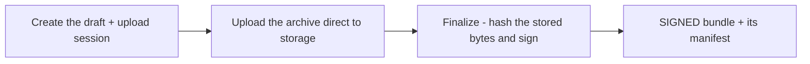

# Manage OTA bundles

OTA bundles are authored per application, from the console's
**OTA bundles** screen in the navigation. The
model — what a bundle is, why only a signed one can publish — is
[OTA updates](/concepts/ota-updates.md); this page is the operator
walk through every control on that screen and the application's
OTA block, in the order a first bundle needs them.

## Enable OTA for the application

1. Open the application's detail page (**Applications**, then its
   row) and find the **Over-the-air updates** block.
2. Flip the toggle. A disabled application refuses bundle
   authoring, app-token issue, alert-rule creation, and the device
   check — the authoring surfaces answer
   `APPLICATION_NOT_OTA_ENABLED` until the toggle is on.

The same block carries the **Manage OTA bundles** button, which
jumps straight to the authoring screen.

## Copy the signing key for the SDK

Every bundle is Ed25519-signed by an app-scoped key. The key does
not exist until the application's **first finalized bundle**
generates it — a finalize-time act, never a read side effect — so
the block shows *No signing key yet* until then.

Once it exists, the block shows the algorithm, the `keyId`, and
the Base64 public key — with a **Copy keyId** button beside the
`keyId` and a **Copy** button beside the public key:

- **Copy keyId** and **Copy** (the public key) — the pair an app
  embeds so devices can verify signatures themselves. The private
  half never leaves ShipperDog's secret store.
- Rotation is generational: a new `keyId` supersedes the old one,
  and signatures made under the old generation stay verifiable
  against its retained public half until the generation retires.

## Issue the device app token

The shipped app identifies itself with an `sdc1.` app token — an
identifier, not a secret — issued once per application from the
**Device app tokens** section of the OTA bundles screen:

1. Click **Issue token**, give it a name (1-200 characters, how
   the registry distinguishes tokens), and confirm.
2. The **Copy the app token now** dialog shows the value **exactly
   once** — the registry stores only its SHA-256 and cannot
   recover it. Copy it, embed it in the app, and only then click
   **I have stored it**.

To retire a compromised or retired-build token, click **Revoke**
on its row: every device check presenting it fails from that
moment on. Revoking an already-revoked token is a safe replay.

## Upload and sign a bundle

Click **Upload bundle** to open the wizard. Fill in:

- **Bundle version (semver triple)** — labels the bundle's own
  versions row (for example `2.4.1`).
- **Platform tag** — an open vocabulary of 1-32 characters
  (for example `js-bundle`).
- **Minimum app version (optional)** — devices on older store
  builds never see the bundle.
- **Forced** — whether the update applies without asking.
- **Choose the bundle archive** — the platform-agnostic archive
  itself.

One click — **Create, upload, and sign** — runs the whole chain:

Finalize lands the **SIGNED** row and shows the manifest devices
verify against: the `sha256`, size, platform tag, signing `keyId`,
and the signature — with copy buttons on the checksum, the
`keyId`, and the signature. If the secret store is momentarily
unreachable the finalize answers `SIGNING_UNAVAILABLE` (503);
retry it.

The screen's listing carries the SIGNED-and-later rows (Signed,
Released, Revoked) with the status filter; draft and mid-upload
rows are not listable.

## Revoke a bundle

**Revoke** on a SIGNED bundle row withdraws it: the device check
answers no-update for that bundle from then on. The confirmation
dialog spells out the distinction — this is the *author's*
withdrawal, not a device-side rollback.

A bundle that already belongs to a release cannot be revoked
(`BUNDLE_NOT_REVOKABLE`): pull it back through the release's
[rollback](/how-to/console/rollback.md) instead.

## Author alert rules

The **OTA alert rules** section watches the application's OTA
metrics. Click **New rule** and set:

- **Metric** — a count (checks, devices seen, downloads, applied,
  failures, rollbacks) or a fraction (apply failure rate,
  crash-free rate).
- **Comparator and threshold** — counts are integers; rates are
  0..1 fractions (crash-free rate `<` `0.995`, for example).
- **Window** — 1 to 10080 minutes.
- **Severity** — info, warning, or critical.
- **Bundle scope (optional)** — empty watches the whole
  application.

Rules persist and fire into the
[OTA dashboard](/how-to/console/ota-rollouts.md)'s alerts feed and
the notification channels; a rule with a standing firing wears a
**firing** chip on its row. Deleting a rule that has ever fired is
refused (`ALERT_RULE_HAS_FIRINGS`) — update it instead, so its
firing history stays addressable.

## Publish and roll out

A signed bundle publishes on an
[ordinary release](/how-to/console/releases.md) over a ring whose
distribution channel is `ota` — exactly one bundle per OTA
release, the full governance stack included. From there the
rollout is its own job:
[run OTA rollouts](/how-to/console/ota-rollouts.md).

**Related guides:** [run OTA rollouts](/how-to/console/ota-rollouts.md) ·
[work with releases](/how-to/console/releases.md) ·
[roll back a release](/how-to/console/rollback.md) ·
[OTA updates concepts](/concepts/ota-updates.md)
