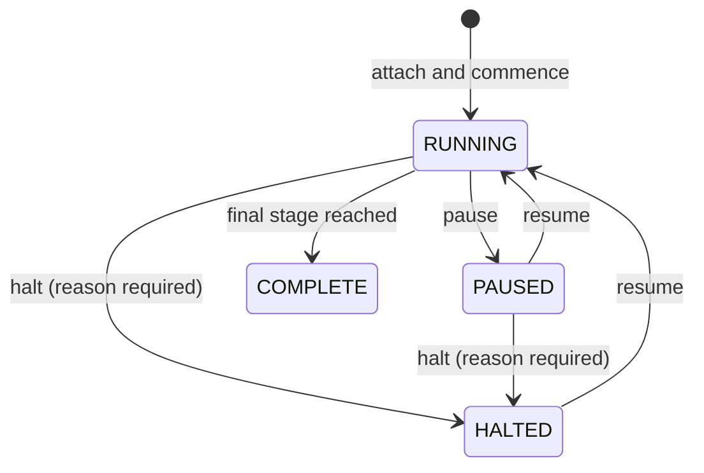

# Run OTA rollouts

An OTA rollout stages a live OTA release across the device fleet
on a cumulative ladder — which device lands in which stage is
decided deterministically, and the ladder only widens. The model
is [OTA updates](/concepts/ota-updates.md); this page drives the
controls. Once a plan exists, the release dashboard carries an
**OTA staged rollout** block beside the channel curves (see
[work with releases](/how-to/console/releases.md)).

## Attach the plan

One rollout plan per OTA release. Attaching happens through the
API — the console renders the controls from there:

```bash
curl -X POST "$SHIPPERDOG_API/api/v1/ota/rollouts" \
  -H "Authorization: Bearer $TOKEN" \
  -H "Content-Type: application/json" \
  -d '{
        "applicationId": "<app-uuid>",
        "releaseId": "<release-uuid>",
        "mode": "CHECKPOINT",
        "stages": [
          { "basisPoints": 1000, "note": "internal canary" },
          { "basisPoints": 5000 },
          { "basisPoints": 10000 }
        ]
      }'
```

The `shipperdog ota promote` CLI verb attaches and commences the
same plan.

- **Stages** — each is a cumulative basis-point threshold
  (10000 = everyone), strictly ascending, the last exactly 10000:
  the ladder widens, never retreats. An optional note (1-512
  characters) rides each stage.
- **Mode** — `AUTOMATIC` (the policy engine decides between
  stages) or `CHECKPOINT` (a Release Manager approves each one).
- The release must be live (ACTIVE or PROMOTED) and carry its OTA
  bundle — otherwise the attach answers
  `ROLLOUT_RELEASE_NOT_LIVE` or `ROLLOUT_RELEASE_NOT_OTA`.

A malformed ladder answers `INVALID_REQUEST` naming every
offending field.

## Drive the rollout

The block shows the status chip (running, paused, halted,
complete), the mode badge (*automatic (policy-gated)* or
*checkpoint (RM approval)*), **stage N of M — X% of the fleet**,
each stage's line with its note and reach time, and the
append-only timeline beneath.



Every control opens a confirmation dialog; the reason field is
audited with the action and **required for halt**:

- **Advance** (labeled **Approve and advance** in checkpoint
  mode) — widen to the next rung. Running plans only.
- **Pause** — hold at the current stage: devices already served
  keep their manifest, new devices still get the current stage,
  nothing widens.
- **Resume** — return a paused or halted plan to running, serving
  what it had reached; resuming widens nothing by itself.
- **Halt** — the human stop. While the plan stands halted, the
  device check answers no-update for the release. The reason is
  mandatory and rides the timeline and the audit event.

Halting is deliberately manual: alert rules page a human through
the notification bus, but no threshold ever stops a rollout by
itself. Halting stops the rollout; the release itself is pulled
back the ordinary way —
[roll back a release](/how-to/console/rollback.md).

## When the console answers 409

Control actions are guarded by the rollout's own 409 family
(details verbatim from the
[error-code registry](/reference/error-codes.md)):

| Code | What it means | What to do |
|---|---|---|
| `ROLLOUT_CONFLICT` | The rollout plan already exists or changed concurrently; reload and retry. | One plan per release. On a control race the console re-reads the plan — act on the fresh state. |
| `ROLLOUT_ACTION_INVALID` | The action is not valid for the plan's standing. | Check the status chip — a complete plan accepts no controls. |
| `ROLLOUT_BLOCKED` | The advancement is blocked: resolve the policy rule first. | The AUTOMATIC mode's policy refusal — the evidence rides the error detail. |
| `ROLLOUT_RELEASE_NOT_LIVE` | The release is not distributing; a rollout plan commences on a live (ACTIVE or PROMOTED) release. | Attach once the release is live. |
| `ROLLOUT_RELEASE_NOT_OTA` | The release carries no OTA bundle; rollout plans belong to OTA releases. | Check the release's ring channel and its bundle. |

## Read the OTA dashboard

Open it from **Tenants** — the **OTA** action on a tenant's row.
Pick the application and bundle (SIGNED-and-later bundles); an
optional ring filter narrows the funnel to one ring's devices.
The view is live, refreshing every 30 seconds.

- **Alerts** — severity badges (critical, warning, info), the
  standing firings, and the recent resolved history, each with
  its rule expression, observed value, and times. The rules are
  authored on the
  [OTA bundles screen](/how-to/console/ota-bundles.md).
- **Device funnel** — Checks (counted server-side) beside the
  device-reported journey: devices seen, downloads, applied, with
  the failed and rolled-back totals and the apply success rate —
  applied over applied-plus-failed.
- **Failure reasons** — failed applies broken down by reason
  (`checksum_mismatch`, `signature_invalid`, `apply_error`, for
  example).
- **Adoption over time** — the daily curve of devices carrying
  the bundle.
- **Crash-rate comparison** — the new bundle against the current
  released one: crash-free rate, sessions, crashes on both
  sides, and the delta in percentage points. A negative delta is
  the halt signal; a comparison needs both sides present.

The organization and tenant rollups live on
[the dashboards](/how-to/console/analytics-and-dashboards.md);
the OTA dashboard is the per-bundle grain beneath them.

**Related guides:**
[manage OTA bundles](/how-to/console/ota-bundles.md) ·
[run a staged tenant rollout](/how-to/console/staged-rollout.md) ·
[read the dashboards](/how-to/console/analytics-and-dashboards.md) ·
[OTA updates concepts](/concepts/ota-updates.md)
