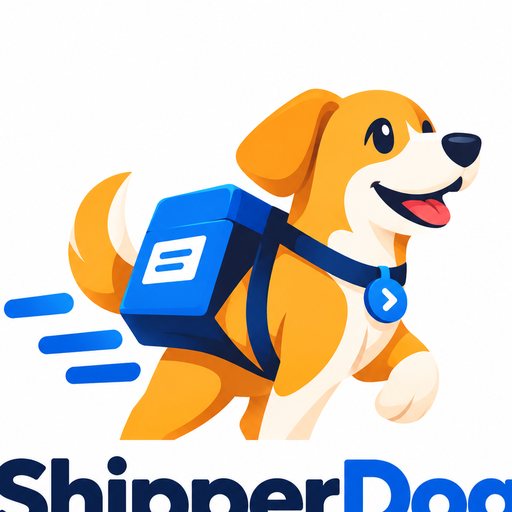

# ShipperDog Developer Documentation

  

Developer-facing documentation lives here. As stories land, this directory
gains: runbooks and deeper operational guides.

Current contents:

- [API conventions](api-conventions.md) — the single error envelope
  (RFC 7807 problem+json + stable codes), opaque concealed-404 denials,
  cursor pagination, Idempotency-Key contract, payload serialization
  rules, and the generated OpenAPI contract with its CI breaking-change
  gate (S1-08).
- [Error code registry](error-codes.md) — every stable public error code,
  its HTTP status and detail text (S1-08).
- [Database migrations](database-migrations.md) — Flyway conventions, enum
  policy, seed fixture, and the forward-only rollback strategy (S1-02).
- [Authentication](authentication.md) — identity module endpoints, token
  semantics (rotation, family revocation, PATs), lockout and reset
  behavior, AUTH_* configuration (S1-03), and organization-scoped
  single sign-on — OIDC (S14-01) and SAML (S14-02) over one shared
  identity-resolution layer.
- [Authorization](authorization.md) — RBAC permission catalog and role
  matrix, the single enforcement point, deny-by-default and opaque
  denials, role-assignment endpoints and guards (S1-05); the layered
  authorization engine of PRD 11/12 — seven ordered layers, the
  entitlement seam S7-02 plugs into, audited decisions, and the
  admin-only decision inspection API (S7-01).
- [Organizations](organizations.md) — organization lifecycle, settings,
  and membership surface (S1-04, extended by S1-05).
- [Tenants](tenants.md) — tenant lifecycle under an organization,
  identifier uniqueness, deactivation semantics, tenant isolation
  semantics, member management with the suspension switch, and the
  applications surface (tenant effective-visibility listing, registry,
  ownership scopes, shared-app authorization, org-wide administration
  listing, versions under an application with their lifecycle and
  permanent history, and the seam-served artifact uploads with their
  object-storage layout and background extraction) (S2-01, S2-02,
  S2-03, S3-01 through S3-04, S4-01 through S4-03, S5-01, S5-02).
- [Artifacts](artifacts.md) — the artifact surface end to end: upload
  routes and object storage (S5-01), the read route with its
  asynchronous extraction tier and stored failure codes, the parser
  port with its iOS (S5-02) and Android APK/AAB (S5-03) implementations,
  build-provenance capture and its frozen CI-integration field names
  (S5-04), the validation pipeline and artifact state machine with
  its per-stage failure codes and the revalidation surface (S5-05),
  ARTIFACT_* environment configuration, and the
  duplicate/immutability rules.
- [Releases](releases.md) — the release model, creation, and targets
  (S9-01): the DRAFT distribution event with per-platform READY
  artifacts, target tenants + tester groups, and the starting ring
  (the S10-04 ring data model pulled forward as seeded reference
  data); the 422 per-tenant target validation; the quotable R-number
  ids; the filtered listing and detail; INV-004's artifact-set freeze
  and the ownership-scope precondition the landing binds. Since S9-02:
  the PRD 17 lifecycle — guarded transitions with the compare-and-set
  race discipline, the mandatory failure/rollback reasons, the
  append-only actor-carrying history timeline, and the ROLLED_BACK
  direct-channel download cutoff.
- [Environments](environments.md) — the environment surface (S9-04):
  the organization-grain deployment contexts (seeded defaults plus
  customs) with their two-value lifecycle, the versioned
  configuration snapshots with retrieval by version, the tenant
  assignment allow-list release creation validates targets against
  (deny-by-default), the reference-only credential bindings with the
  resolution probe (secret references, never material — PRD 25), and
  the release-creation and manifest-freeze integration (the
  environment code and the RESOLVED configuration values freeze at
  APPROVED).
- [Admin console](frontend.md) — the React/MUI console (S2-04, S3-04):
  stack and structure, the shared API client (problem+json, correlation
  ids, cursor pagination), token storage and silent refresh, role-aware
  navigation probes, screens including the application console, CI
  gate, and local development.
- [Tester portal](portal.md) — the tester-facing app in `portal/`
  (S8-01): a separate React/MUI bundle on :5174 with tester login,
  the invitation-accept entry, silent refresh with the narrowed
  /auth/me retry, session isolation from the console, and the honest
  empty home.
- [SIEM export](siem.md) — the audit trail as a real-time compliance
  feed: the versioned exported-event schema, the signed HTTPS
  collectors, the bucket batches with signed manifests, and the
  verification recipes (S14-05)
- [Audit logging](audit.md) — append-only audit trail, transactional
  persistence, redaction, correlation ids, and the admin query API
  (S1-06).
- [Testers](testers.md) — tester onboarding and invitations (S6-01)
  and lifecycle revocation (S6-04): organization-scoped tester
  records, the reused invitation machinery with the 7-day single-use
  token, accept flow through registration, the
  INVITED/ACTIVE/SUSPENDED/DISABLED lifecycle with login/refresh/PAT
  enforcement, deactivation with mandatory reason, membership cascade,
  session kill and the revocation latency SLA, email delivery through
  the notification seam, and TESTER_* configuration.
- [Tester groups](tester-groups.md) — tenant-scoped tester collections
  (S6-02): group CRUD on the isolation seam, idempotent membership
  add/remove over the composite-PK junction, default-group seeding on
  tenant creation, and the testers-per-group / groups-per-tester
  listings.
- [Tenant-tester memberships](tenant-tester-memberships.md) — the
  portal-access join between testers and tenants (S6-03): link /
  suspend / history-preserving removal over the seam-joined composite
  key, the two-switches effective-access rule, both listings, and the
  group-membership precondition.
- [Devices](devices.md) — the tester-device registry of one tenant
  (S11-03): manual registration with the tenant-scoped identifier
  uniqueness, the reversible park (rows are never deleted), the
  admin-only provisioning CSV export, the feedback device link, and
  the console surface.
- [Release analytics](analytics.md) — the FR-029 metrics dictionary,
  the facts-to-rollups-to-reads pipeline, the frozen S15-01 SDK events
  contract, the rollup job and its backfill, and the gate/policy
  metric seams the pipeline registers on (S11-04)
- [Tester telemetry SDK](telemetry-sdk.md) — the embedded SDK of
  PRD §37 (S15-01): the Kotlin/Android and Swift/iOS libraries with
  their ≤ 5-line integrations, the telemetry token the download
  issuance mints (the events contract's SDK authority), offline
  batching with (device, release, event id) dedup, chainable crash
  context, the feedback deep link, the OTA updater (Android, S16-12),
  and the size/battery budgets
- [OTA updates](ota.md) — the device-facing contract of the OTA
  milestone (S16, ADR-0010): the `sdc1.`-authenticated check and its
  manifest, the Ed25519 signing contract, the lifecycle telemetry
  vocabulary, rollout bucketing and halt semantics, and where every
  surface lives (console, CLI, portal, SDKs)
- [Companion app spike](companion-spike.md) — the S15-02 decision
  memo for PRD §38's conditional Android companion installer app:
  the working prototype in companion/ (catalog, PackageInstaller
  flow, update tracking — verified against the live stack), the
  Android platform constraints discovered (consent on every install,
  no silent updates, Play policy), substrate decisions (portal
  session auth; the SDK doctrine, not its code), platform gaps
  productionization would close, the build-cost estimate, and the
  explicit no-go-on-productionization-today verdict with concrete
  revisit triggers
- [Dashboards](dashboards.md) — the console's landing surfaces (S11-05):
  the organization dashboard (counts, per-application release health
  with the BLOCKED/TESTING/HEALTHY derivation, role-filtered pending
  actions) and the tenant dashboard, the two read APIs behind them,
  and the series-folding rule (counts sum, rates never do) every
  chart consumer of the analytics reads follows — plus the OTA
  dashboard endpoints (S16-10): the bundle funnel (stages, failure
  reasons, adoption curve, ring filter) and the current-vs-new
  crash-rate comparison the console's OtaDashboardPage renders
- [Notifications](notifications.md) — the domain-event bus and the
  notification service (S12-01): the transactional outbox and the
  at-least-once relay behind the DomainEventBus port (ADR-0007), the
  frozen event-name vocabulary and its mapping table, the org-scoped
  subscription CRUD (events x channels x recipients), the in-app
  inbox, signed webhooks with the receiver's HMAC verification recipe,
  and the delivery ledger with its retry policy — plus the Slack and
  Teams chat channels riding that machinery (S12-02): the per-event
  message templates, the Block Kit and connector-card bodies, deep
  links into the console, and the subscription test message
- [Observability](observability.md) — tracing/metrics/logs baseline,
  correlation model, `shipperdog_*` metric namespace, Prometheus +
  Grafana local stack, and the management-port security posture
  (S1-07).
- [CLI](cli.md) — the Go developer CLI (S5-06): command surface,
  credentials store (PAT in `~/.shipperdog/credentials`, 0600), the
  endpoint contract test pinning every URL to the OpenAPI baseline,
  exit-code contract for CI, and the cli-ci gate with its cross-compile
  matrix.
- [CI integration](ci.md) — the GitHub Actions story (S12-03): the
  `upload-artifact` and `promote-release` composite actions wrapping
  the CLI (provenance auto-captured from the GHA context, blocker
  lists in the job summary), the PAT-as-secret least-privilege
  strategy with the OIDC/GitHub-App upgrade path, and the signed
  `POST /webhooks/github` receiver — the generic inbound-webhook
  framework (constant-time HMAC over a rotating secret list,
  delivery-id idempotency, the S12-04 replay seam) and the
  workflow_run provenance backfill.
- [CI integration: Jenkins](ci-jenkins.md) — the Jenkins story
  (S12-04, issue #54): the `shipperdogUpload`/`shipperdogPromote`
  shared-library steps wrapping the CLI with provenance from the
  Jenkins environment (GIT_COMMIT/BRANCH_NAME/BUILD_URL), the
  Jenkinsfile example, and the receiver-defined HMAC contract behind
  `POST /webhooks/jenkins` (Jenkins has no standard webhook
  signature — the snippet signs the exact body bytes with openssl).
- [CI integration: GitLab](ci-gitlab.md) — the GitLab story (S12-04):
  the include-able `.shipperdog-upload`/`.shipperdog-promote` job
  templates with provenance from the GitLab CI env
  (CI_COMMIT_SHA/CI_COMMIT_REF_NAME/CI_PIPELINE_URL), and the
  token-authenticated `POST /webhooks/gitlab` receiver consuming
  successful pipeline events (TLS mandatory — GitLab signs nothing).
- [Webhook reference](webhooks.md) — all five inbound receivers
  (S12-03/S12-04): the auth model per provider, the two
  uniform-rejection families (401 shared-secret, 400 store), the
  receipt vocabulary (ACCEPTED/IGNORED/DUPLICATE), the two-layer
  replay defense (timestamp window + delivery ledger) plus the store
  events' domain-grain key, the thin `store_status_events` mapping
  E13 consumes, and the hardening posture — metrics, audit,
  per-client rate limits, and the bounded-read body filter.
- [SCIM provisioning](scim.md) — the SCIM 2.0 joiner/leaver
  automation (S14-03, issue #69, PRD 25): the `/scim/v2` surface and
  its connector-token authority (one live token per organization,
  SHA-256 at rest, plaintext once), the group-to-role/tenant mapping
  rules with their doctrines (most-privileged-wins,
  additive-only tenant grants), the externalId-first idempotent
  upsert, the leaver hard-lock cascade and the re-provision
  manual-restoration doctrine, the identity-provider setup guide
  (Entra, Okta, Google Workspace), and the scim+json error envelope
  deviation.
- [ADR-0001: Flyway with plain SQL migrations](adr/ADR-0001-flyway-schema-migrations.md)
- [ADR-0002: Predicate-injection repository seam for tenant isolation](adr/ADR-0002-tenant-isolation-data-seam.md)
- [ADR-0003: Artifact object storage behind the ArtifactStore port](adr/ADR-0003-artifact-object-storage.md)
- [ADR-0004: CLI implemented in Go with a contract-tested thin client](adr/ADR-0004-cli-toolchain.md)
- [ADR-0005: M1 deploys to Cloud Run over a private VPC data tier](adr/ADR-0005-cloud-run-deployment.md)
- [ADR-0006: Portal and console sessions stay in localStorage for M1, hardened by CSP](adr/ADR-0006-portal-session-token-storage.md)
- [ADR-0007: The domain-event bus ships in-process over a transactional outbox; the broker is a swap behind one port](adr/ADR-0007-event-bus-transport.md)
- [ADR-0008: Credential material lives behind a secret-store port — GCP Secret Manager in production, an AES-256-GCM envelope store as the self-hostable default](adr/ADR-0008-credential-secret-storage.md)
- [ADR-0009: SAML Response validation is a scoped in-house layer over Apache Santuario's XML-DSig — never a hand-rolled signature path, never a full SAML object framework](adr/ADR-0009-saml-validation-stack.md)
- [ADR-0010: OTA updates ride the existing release machinery — an `sdc1.` app token identifies devices, app-scoped Ed25519 keys stay in the secret store, and the telemetry funnel splits between server and device](adr/ADR-0010-ota-updates.md)
- [OTA updates implementation plan](ota-updates-plan.md) — the approved
  OTA Updates design (PR #161): decisions D1-D11, the component
  change analysis, the 16-issue tree, the key reuse map, and the
  verification gates. ADR-0010 is its architecture anchor.
- [Distribution: channel adapters and credential delegation](distribution.md) —
  the adapter SPI (S13-01): the one interface every delivery channel
  implements as a bean (capabilities, `distribute`/`status`, the
  failure taxonomy), the credential-delegation chain (org -> app ->
  app+environment, first-defined-wins per provider, PRD 25), the
  store connectors (TestFlight #62, the App Store's production
  submission + phased release #63, Google Play's testing tracks
  #64 and production staged rollout #65), the staged TENANT
  rollout and orchestrated rollback (S13-06, #66: deterministic
  seeded cohorts, gated/checkpointed advancement, per-channel
  arms, one-action rollback), the two
  secret stores behind one port (ADR-0008), the ACTIVE-crossing
  dispatch and its distribution records (external ids for store
  reconciliation), the per-adapter sandbox (timeout, bounded
  category-keyed retries, `shipperdog.adapter.call.duration` trace
  and timer), and the add-an-adapter guide — a new store plugs in
  with zero core changes.
- [Deployment runbook (Cloud Run, M1)](deployment.md) — terraform stack,
  deploy workflow, smoke test, rollback, observability posture (S8-05).

Start with the top-level README for local setup and CI.
