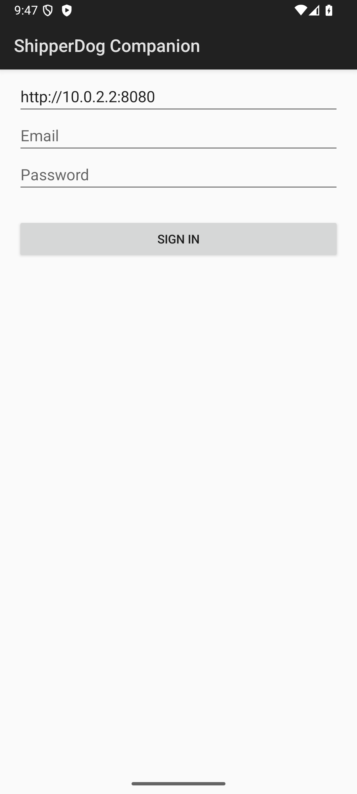
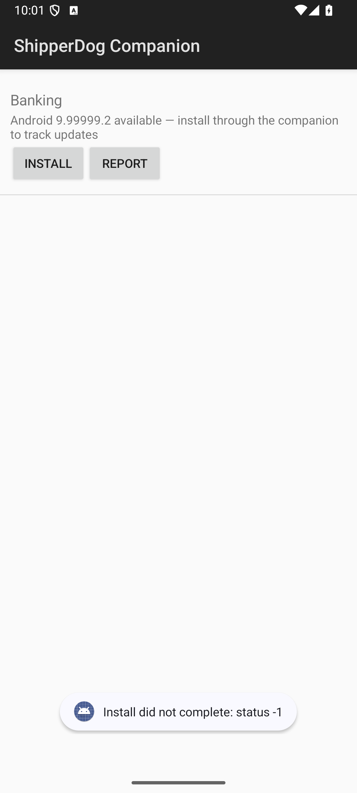

# Companion App Spike (S15-02)

The decision memo for issue #73 — PRD §38's conditional V3 item,
evaluated the way the story demands: evidence first, prototype second,
explicit decision third. The Android companion installer app is a
tester's install surface for direct distribution (authorized catalog,
one-tap PackageInstaller install/update, installed-version tracking,
feedback deep link); iOS has no equivalent by platform policy (FR-012)
and this evaluation stays Android-only by design.

- The recommendation: [Go/no-go](#go-no-go) — **no-go on
  productionization today, with concrete revisit triggers**; the
  prototype lands as the reference implementation
- What was built: [The prototype](#the-prototype)
- What the spike run proved: [Evidence from the prototype
  walkthrough](#evidence-from-the-prototype-walkthrough)
- Substrate decisions: [Auth and transport](#auth-and-transport)
- What productionization needs: [Platform gaps](#platform-gaps) and
  [Android constraints](#android-constraints-discovered)
- Cost: [Build-cost estimate](#build-cost-estimate)
- The decision's basis: [Usage evidence](#usage-evidence-review) and
  [Revisit triggers](#revisit-triggers)

## Usage evidence review

The story gates the build on "M3 usage data show[ing] direct APK
distribution is a primary channel and portal friction is measurable."
The honest state of that evidence today:

- **There is no production usage data.** ShipperDog is greenfield; M3
  shipped the measurement machinery but no fleet runs it yet. The
  spike's own evidence bar — portal analytics on Android
  direct-download completion rates, support-ticket friction themes —
  cannot be met by a platform with zero production testers. The
  decision below is therefore fail-closed on the story's own gate,
  not a judgment that the idea is bad.
- **What IS measurable today:** every download now flows through the
  issuance route's decision trail (S8-04), and S15-01's telemetry
  contract closes the loop from install to engagement — INSTALL and
  SESSION events feed `INSTALLATIONS`, `INSTALL_SUCCESS_RATE`, and
  `CRASH_FREE_SESSIONS` in the metrics dictionary, per release and
  per device. The moment a real fleet exists, the exact numbers this
  decision needs are already computed: completion rate
  (downloads issued vs INSTALL events), Android direct-download
  share (platform split of issuances), and friction proxies
  (issuances per tester per version — repeat downloads of the same
  build suggest failed installs).
- **What the platform's own telemetry design expects:** the
  UNINSTALL-absence heuristic in [telemetry-sdk](telemetry-sdk.md#uninstall-absence-heuristics)
  names "a companion installer app — S15-02's spike is the natural
  first emitter" as the honest UNINSTALL observer. The companion is
  not a vanity surface; the metrics pipeline has a slot waiting for
  it.

## The prototype

`companion/` in this repo, built and verified this spike — a working
prototype, deliberately not production polish:

- `core/` — pure Kotlin/JVM, ZERO runtime dependencies (the
  `sdk/android` doctrine: hand-rolled JSON, injectable transport
  seams, JUnit suite): portal session state machine (login, one-retry
  refresh on 401, persistence), catalog/eligibility/issuance clients
  against the EXISTING tester-facing contracts (the portal's own
  routes, third client of the same contracts), the install ledger,
  version ordering, and the derived five-state catalog row.
- `app/` — the Android surface (minSdk 26, plain framework widgets,
  no androidx/compose): login screen, catalog screen with live
  authorized builds, the PackageInstaller session flow with the
  unknown-apps consent routing, and the feedback deep link.
- `demo/` — a REAL AGP-built APK (`com.shipperdog.demo.banking`, the
  seeded demo app's registered package) used as the spike's
  dogfood install target.
- CI gate: `companion-ci.yml` runs the JVM suite and assembles the
  debug APKs on every PR (the sdk-ci precedent: one workflow, one
  component).

Verified: 59 JVM tests green (the walkthrough's 43 plus the
delivery's hostile-input and edge-test additions); the app builds,
installs, and runs on an API 35 emulator; the full walkthrough below
ran against the live compose stack.

## Evidence from the prototype walkthrough

The demo (documented walkthrough; run against `docker compose up` +
the seeded demo data, on the emulator of `companion/README.md`):

1. **Login.** The tester signs in with portal credentials — the
   portal session machinery's own login route, session persisted
   across app restarts (the second launch skips straight to the
   catalog). 
2. **Catalog.** The authorized-applications listing answers live from
   the S7 decision path on every resume (never a cached list — the
   story's own criterion). The dogfood run saw the catalog update
   within seconds of a new version being published server-side.
   
3. **One-tap install.** Tapping Install drives eligibility ->
   issuance -> APK download -> PackageInstaller session. The live
   run reached the OS's user-confirmation gate with the OS having
   validated the staged APK (see the finding below) — the final
   system-dialog tap is the tester's own act, by Android's design.
4. **Update detection.** The catalog derives five honest states
   (not installable / untracked / not installed / up to date /
   update available) from the ledger join against the package
   manager's own facts. Unit-pinned for the version-ordering edges.
5. **Feedback.** The Report action opens the portal's version page
   with `?report=1` — the same S11-01 deep-link contract the
   telemetry SDK opens. (Prototype limitation, honestly noted: the
   companion derives the portal origin from its single configured
   base URL — correct in the same-origin production nginx shape,
   but the local compose dev shape serves the portal on its own
   :5174 origin, so the walkthrough did not exercise the link
   end-to-end. Productionization adds the portal base as its own
   configured field.)

Findings the walkthrough itself produced:

- **The fixture gap.** The portal e2e's APK minter
   (`portal/e2e/apk-fixture.mjs`) satisfies the backend's structural
   validation (FORMAT/METADATA/SIGNING all PASS) but NOT Android's
   on-device package parser ("Corrupt XML binary file" at session
   validation). The portal e2e proves download byte-identity, never
   device install — so nothing had ever exercised the difference.
   The spike's `demo/` module (a real AGP build) is now the honest
   dogfood target; productionizing the e2e minter to a real
   device-installable APK is recorded as follow-up work.
- **The confirmation wall.** On the Play-store system image
   (headless API 35 emulator), the user-confirmation dialog for
   session commits by a third-party installer never surfaces; the
   committed sessions wait forever for the tap. On a device with a
   screen the dialog appears as designed — but the constraint it
   embodies is real and permanent (next section): Android offers NO
   silent-install path to a third-party app, by security design.

## Android constraints discovered

- **`REQUEST_INSTALL_PACKAGES` is policy-gated, not just
  permission-gated.** The manifest declaration makes an app
  ELIGIBLE; the tester's per-app "install unknown apps" consent
  (Android 8.0+ design, `canRequestPackageInstalls()`) makes it
  ABLE. Play's policy additionally requires the permission to be
  core to the app's purpose with a prominent disclosure — a
  beta-distribution installer is the textbook legitimate use, but
  the Play review will scrutinize it. Distribution via direct APK
  (dogfood, this repo's own channel) or Play's INTERNAL test track
  (lighter review) avoids the friction; the story's "optional Play
  internal track" is the right call.
- **No silent installs, ever.** Even with consent granted, every
  commit lands in the system's own install-confirmation dialog.
  "One-tap install" is honest marketing (one tap in the companion,
  one system confirm); "auto-update" in the background is
  impossible without system privileges. The companion's value is
  removing browser/file-manager friction and DISCOVERY friction
  (update detection), not removing Android's consent model.
- **Update installs require signature continuity.** A PackageInstaller
  update replaces an existing package only when signatures match —
  testers who installed the portal-downloaded build keep working
  (same artifact), but a team changing signing keys breaks the
  companion's update path exactly as it breaks adb updates.
- **Version checks are two-dimensional.** `versionName` drives the
  human comparison, but Android's update semantics key on
  `versionCode` monotonicity; the ledger records both (the
  eligibility slot carries buildNumber) and productionization
  should compare both.
- **Cleartext is a dogfood-only affordance.** The prototype enables
  `usesCleartextTraffic` for the emulator's `http://10.0.2.2:8080`
  stack; production pins HTTPS via a network security config.

## Auth and transport

Substrate decisions (the #72 follow-ups the spike owed answers to):

- **Auth: the portal session machinery, reused verbatim.** The
  companion logs the tester in through the same
  `POST /api/v1/auth/login` / `refresh` routes the portal uses —
  third client of the same contracts. The `sdt1.` telemetry token is
  NOT the companion's auth (ingest-only, one authority, bound to one
  release — structurally wrong for an app credential), and a new
  device-token path was not invented: the issuance route's optional
  `device_id` pairing already covers device binding when
  productionization wants it. No backend change needed for auth.
- **Transport: the telemetry core's DOCTRINE, not its code.** The
  SDK's `HttpTransport` is module-internal and POST-only; coupling
  the installer to the beacon would weld two different lifecycles.
  The companion core mirrors the pattern instead (HttpURLConnection,
  injectable seam, hand-rolled JSON) — and the companion DOES
  consume the telemetry block: each brokered download's issuance
  carries the sdt1 token, which the ledger stashes per release.
  That stash is the UNINSTALL-emitter path: when productionization
  adds uninstall observation, the companion holds exactly the
  credential the ingest wants (the SDK's public API would grow the
  emitter entry point — a platform gap below).

## Platform gaps

What productionization needs from the PLATFORM (the spike found
these; none block the prototype):

1. **`bundleId` on the tester-facing contract.** The catalog card
   and eligibility slot name the artifact id and build number but
   never the Android package name — so the companion cannot match a
   PORTAL-installed build to its catalog card (its own installs it
   learns by session diff). One additive field on the eligibility
   slot (the console's `ArtifactView` already carries `bundleId`)
   closes the gap; the prototype's install ledger is the workaround.
2. **An uninstall emitter in the SDK.** `ShipperDog`'s public API
   has no uninstall entry point (by design — a device cannot report
   its own removal; the companion CAN report other apps'
   removals). A `reportUninstall(token)`-shaped addition would let
   the companion feed UNINSTALL events with the stashed per-release
   tokens; the ingest contract already accepts the event type.
3. **(Optional) a companion-visible update channel.** Nothing
   companion-specific exists or is needed for install; but
   "update available" polling is resume-driven in the prototype.
   A push notification path (the platform's notification module
   exists for release events) would be the production polish.

## Build-cost estimate

The prototype cost (measured, this spike): ~2 days of one engineer —
core+app+demo, 43 tests, CI gate, the live-stack walkthrough. The
memo itself is a large fraction of the value delivered.

Productionization estimate (from the prototype's gaps, no gold-
plating): **S-M, roughly 2-3 weeks** —

| Work | Size | Notes |
|---|---|---|
| bundleId on the eligibility contract + OpenAPI regen | S | additive field, one backend touch + tests |
| SDK uninstall emitter + ingest tests | S | public API addition; contract already frozen for the event type |
| App polish: error envelopes, retry states, sign-out flows, network security config, real icon, encrypted token storage at rest | M | the unglamorous 80%; the prototype keeps the session pair in plain SharedPreferences (`allowBackup="false"`, the M1 portal-localStorage precedent — spike-acceptable, inventoried here) |
| Update-detection hardening (versionCode compare, multi-tenant edge cases) | S | ledger already carries the facts; also fixes the lexicographic pre-release suffix compare (rc10 vs rc2) |
| Core parser hardening (JSON depth cap, bounded body reads) | S | hostile-depth input currently overflows the stack instead of refusing loudly; inside the authenticated-server trust boundary — review finding |
| Play internal-track packaging + signing story | S | if that channel is wanted at all |
| E2E minter fix (device-installable fixture) | S | follow-up found by this spike |

Distribution costs nothing beyond hosting the APK (the platform's
own direct-download machinery serves it; dogfood-first).

## Go / no-go

**NO-GO on productionizing today. GO on keeping the prototype.**

Rationale:

- The story's own gate fails closed: no production usage data exists,
  so "direct APK distribution is a primary channel and portal
  friction is measurable" is unproven either way. Building the full
  app now would be spending the S-M estimate on faith, exactly what
  the spike was scoped to avoid.
- The CONCEPT is proven de-risked: the prototype ran the full loop
  against the live stack (login -> live catalog -> issuance ->
  download -> OS-validated session), the existing API surface needed
  ZERO companion-specific endpoints, and the productionization path
  is now a known S-M with named gaps rather than an unknown.
- The costs discovered are permanent Android realities (consent on
  every install, no silent updates, Play policy scrutiny), not bugs
  to fix later: they bound the companion's value ceiling, and the
  revisit decision should weigh them against measured portal friction.

## Revisit triggers

Revisit (flip to GO) when ANY of these holds on a production fleet,
measured with the machinery this repo already ships:

1. **Android direct-download share > 50%** of all download issuances
   over a 30-day window (the fleet actually lives on the channel the
   companion serves).
2. **Install completion gap > 20 percentage points** between Android
   download issuances and S15-01 INSTALL events over 30 days (portal
   friction is measurable and material — testers download but do not
   end up installed).
3. **Friction themes in support volume**: install-related tickets
   (unknown-sources confusion, file-manager failures, stale builds)
   exceed ~10% of tester support volume for a month.
4. **A customer asks for it with a fleet attached** (the enterprise
   deal that wants device-managed beta fleets).

Until then: the prototype stays in `companion/` (CI-gated, tested),
the ledger stash keeps the UNINSTALL-emitter path open, and this memo
is the decision of record.

**OTA channels (S16-16, issue #178 — the D11-era judgment applied):**
no companion updater ships in v1; the catalog's per-platform
resolution instead carries an `ota` flag when the platform's newest
authorized version is an OTA bundle's own row, and `UpdateState`
derives the honest `OTA_CHANNEL` state from it — "updates arrive
inside the app" — instead of misreporting `UPDATE_AVAILABLE` from a
bundle label the device cannot compare. The OTA delivery itself is
the embedded SDK updater's job ([ota.md](ota.md)).

## Acceptance criteria mapping

| Spike AC | Delivered |
|---|---|
| Decision memo with usage evidence, prototype demo, build-cost estimate, explicit go/no-go | This document; usage evidence reviewed honestly (none exists — fail-closed), walkthrough with screenshots above, estimate table, no-go-with-triggers |
| If no-go: document revisit triggers (e.g., direct-download completion < X%) | Four triggers with thresholds above, measurable with shipped machinery |
